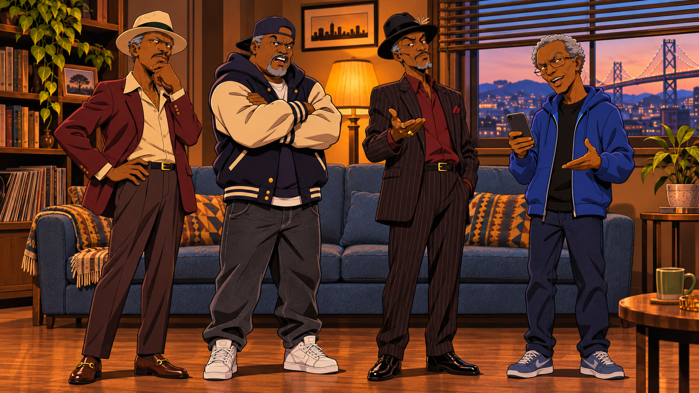

# Four-deep

An original 2D adult animated sitcom about four older Black roommates in an Oakland neighborhood: **Player, Doc, Finesse, and Download**. The comedy uses uncensored dialogue, natural Bay Area slang, character-driven hustles, and everyday household arguments.

## The roommates

| Character | Background and personality | Visual anchor |
| --- | --- | --- |
| Player | Smooth old-school player from East Oakland’s 73rd; relaxed, confident, dry wit. | Cream hat, burgundy blazer, cream shirt, brown trousers and loafers. |
| Doc | Former street pharmacist who still thinks he is young and gangsta; suspicious, blunt, loud when frustrated. | Backward navy cap, gray goatee, navy varsity jacket with cream sleeves, charcoal jeans, white high-tops. |
| Finesse | Street swindler from the Fillmore in San Francisco; persuasive, always explaining his next hustle. | Black fedora, dark pinstripe suit, burgundy shirt, gold rings. |
| Download | Oakland technology genius whose inventions sometimes backfire; precise until the others get on his nerves. | Gray curls, rectangular glasses, blue hoodie, navy jeans, smartphone. |

## Production assets

- [Full-body living-room cast reference](assets/references/01_Living_Room.png)
- [Front porch standing scene](assets/references/02_Front_Porch.png)
- [Corner store standing scene](assets/references/03_Corner_Store.png)
- [Original facial and expression reference](assets/references/Original_Character_Reference.jpg)
- [Character continuity, approved dialogue, scene prompts, and animation prompts](production/standing-shots-and-prompts.md)

## Ready-to-produce shorts

| Scene | Title | Target assembled duration |
| --- | --- | --- |
| Living room | Smart House | 20 seconds |
| Front porch | Rent Collection | 20 seconds |
| Corner store | The Investment | 22 seconds |

These three scenes currently include images and production prompts. Their videos have not been rendered. For tools with shorter clip limits, produce separate speaker segments and assemble them in the approved order.

## Continuity and performance

Use the actual images as references for every new generation. Preserve faces, ages, skin tones, body builds, hats, glasses, wardrobe, footwear and relative heights. The full-body cast order is Player, Doc, Finesse, Download, from left to right. Keep the bold ink outlines and rich 2D cel shading.

Keep each character’s voice distinct: Player smooth and dry, Doc gravelly and blunt, Finesse persuasive and unbothered, Download precise and technical. The approved scripts include profanity and Bay Area vocabulary. Perform it naturally rather than adding slang to every line. Only the active speaker moves his mouth.

For vertical Reels, compose a new 9:16 shot from the same references; center-cropping the widescreen group would remove characters. Review faces, hands, wardrobe, exact dialogue and lip sync before publishing. Prioritize free tools and check costs before rendering.

## Music and sound effects

[Audio kit: three CC BY music tracks, 100 CC0 sound effects, credits and video cue sheet](assets/audio/README.md). Third-party audio retains its own licenses; see the kit before publishing.

## Four-video upload batch

[Upload instructions](production/four-video-upload-instructions.md), [posting captions and hashtags](production/four-video-posting-captions.csv), and [four render requests](production/four-video-requests.json). These four new videos are prepared, not rendered.

## Existing pilot clip

[Watch AI Paid the Rent](https://cdn.creativeclaw.co/u/595a4a51/videos/a19c99cb-9b2e-4ab6-90f5-537c75ef159d.mp4). This is the existing 15-second generated pilot, separate from the four unrendered Shorts above.

## Current batch status

The four requested 10-second vertical Shorts are **Smart House**, **Rent in Transit**, **Professional Hustler**, and **Dating at 66**. Their exact dialogue, prompts, titles, captions, hashtags, and reference frames are in `production/` and `assets/references/`. These are production inputs, not finished videos.

The November 4, 2026 estimate remains 50 credits per clip (200 for four); the checked Creative Claw balance is 98. No new video generation was submitted during this restoration. Do not automatically spend credits or buy a plan.

Third-party music and effects retain the licenses recorded in `assets/audio/`. The repository MIT license does not override third-party audio licenses. Include the appropriate music credit when using a track.
